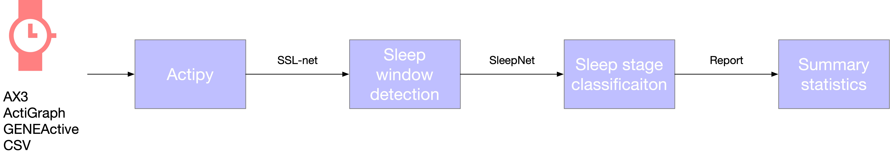

# sleeper: a sleep classifier for wearable sensor data using machine learning
This is a Python package for classifying sleep stages from wearable sensor data / wrist - worn accelerometer. The underlying model
was trained and tested in 1000 + nights of multi - centre polysomnography with tri - axial accelerometer data.

The key features of this package are as follows:
* A simple and easy - to - use API for sleep stage classification.
* Sleep / wake metric estimation including total sleep duration and sleep efficiency.
* Sleep architecture metric estimation including rapid - eye - movement(REM) / NREM sleep duration.





# Dependencies
- Python 3.8
- Java 8 (1.8.0) or greater

Check with:
```bash
$ python --version
$ java -version
```

# Installation
```bash
$ pip install sleeper
```

# Development checks

Install the development dependencies and run the same quality gates used by tox:

```bash
$ pip install -e '.[dev,test]'
$ ruff check .
$ mypy
$ pytest
```

# Usage
All the processing will be much faster after the first time because the model weights will to have to be downloaded
the first time that the package is used.
```shell
# Process an AX3 file
$ get_sleep sample.cwa

# Or an ActiGraph file
$ get_sleep sample.gt3x

# Or a GENEActiv file
$ get_sleep sample.bin

# Or a CSV file (see data format below)
$ get_sleep sample.csv
```

Output
```shell
Summary
-------
{
    "Filename": "sample.cwa",
    "Filesize(MB)": 65.1,
    "Device": "Axivity",
    "DeviceID": 2278,
    "ReadErrors": 0,
    "SampleRate": 100.0,
    "ReadOK": 1,
    "StartTime": "2013-10-21 10:00:07",
    "EndTime": "2013-10-28 10:00:01",
    "Total sleep duration(min)": 655.7,
    "Total overnight sleep(min)": 43132,
    ...
}

Estimated total sleep duration
---------------------
              total sleep duration(min)
time
2013 - 10 - 21     435.2
2013 - 10 - 22     436.2
2013 - 10 - 23    432.2
...

Output: outputs /sample/
```

# Visualisation
You can visualise the sleep parameters using the following command:
```shell
$ visu_sleep PATH_TO_OUTPUT_FOLDER
```


# Processing CSV files
If a CSV file is provided, it must have the following header: time, x, y, z.

Example:
```shell
time, x, y, z
2013 - 10 - 21 10: 00: 08.000, -0.078923, 0.396706, 0.917759
2013 - 10 - 21 10: 00: 08.010, -0.094370, 0.381479, 0.933580
2013 - 10 - 21 10: 00: 08.020, -0.094370, 0.366252, 0.901938
2013 - 10 - 21 10: 00: 08.030, -0.078923, 0.411933, 0.901938
```


# License
This project is released into the public domain under the [Unlicense](LICENSE). See [NOTICE](NOTICE) for third-party notices.

# Maintainer documentation

See [RELEASING.md](RELEASING.md) for the package release process.
